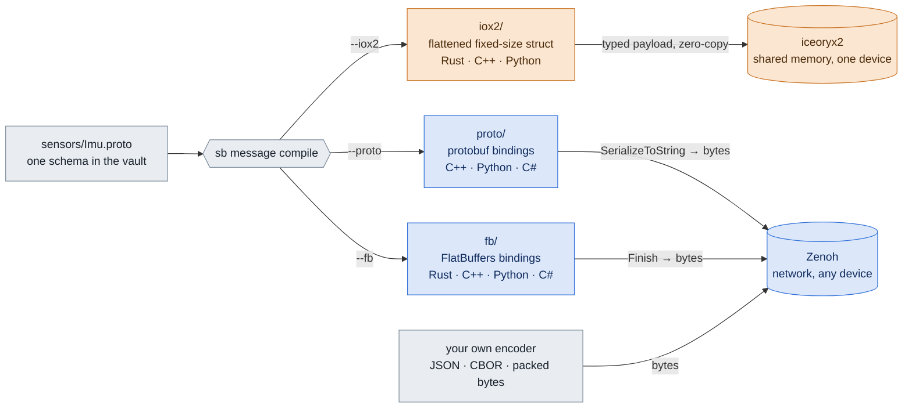
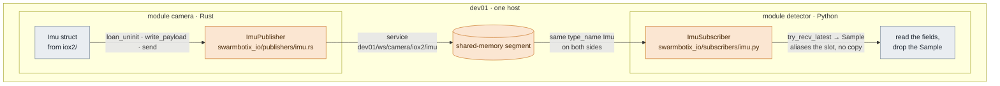
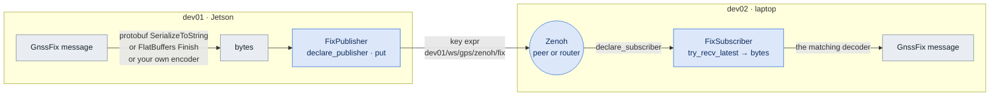
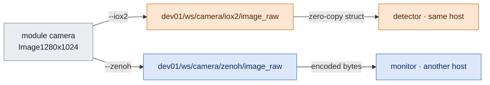

<h1 align="center">swarmbotix CLI</h1>

<h3 align="center">One toolchain for building, launching, and inspecting a polyglot pub/sub swarm</h3>

<h4 align="center">
  <a href="#installation">Install</a>
  |
  <a href="#quick-start">Quick Start</a>
  |
  <a href="documents/sbcli.md">Docs</a>
  |
  <a href="installguide_ubuntu.md">Linux Guide</a>
  |
  <a href="installguide_windows.md">Windows Guide</a>
  |
  <a href="https://github.com/swarmbotix/sbcli/releases">Releases</a>
</h4>

<div align="center">
  <a href="https://github.com/swarmbotix/sbcli/actions/workflows/build.yml"></a>
  <a href="https://github.com/swarmbotix/sbcli/releases/latest"></a>
  
  
  
</div>

<br/>

# swarmbotix CLI (`sb`)

**`sb` is a single Rust binary** that gives you one toolchain for building,
launching, and inspecting a heterogeneous pub/sub system across **Rust, Python,
C++, Flutter, and Unity**, over two transports: **[Zenoh](https://zenoh.io/)**
for the network and **[iceoryx2](https://github.com/eclipse-iceoryx/iceoryx2)**
for zero-copy shared memory on one device.

> `sb` does **not** mock, wrap, or hide either transport. Generated code calls
> `zenoh::Session::open` and `iceoryx2::node::NodeBuilder` directly. There is no
> swarmbotix runtime and nothing is added to your application's dependencies:
> `sb` is build-time and launch-time orchestration only, and it never touches
> your build system.

---

## Table of Contents

- [Features](#features)
- [How Messages Travel](#how-messages-travel)
- [Installation](#installation)
- [Quick Start](#quick-start)
- [CLI Commands](#cli-commands)
- [On-Disk Layout](#on-disk-layout)
- [Architecture](#architecture)
- [Language Support](#language-support)
- [Versions](#versions)
- [Documentation](#documentation)
- [Development](#development)
- [Contributing](#contributing)
- [License](#license)

## Features

### Two transports, one workflow

- **Zenoh for the network** -- cross-device pub/sub; the same generated code
  runs on a laptop, a Jetson, or a phone
- **iceoryx2 for shared memory** -- zero-copy, typed payloads between processes
  on one host, for image and point-cloud rates
- **Pick per publisher** -- `--zenoh` or `--iox2` on each `sb io add pub` /
  `sb io add sub`; a module can use both at once
- **Payload encodings** -- on Zenoh each entry carries protobuf (with a typed
  `publish(msg)` and receive in Rust, Python, and C++), FlatBuffers, or raw
  bytes tagged with a MIME type such as `text/json`; `sb topic listen` decodes
  all of them
- **Uniform topic naming** -- every topic is
  `<device>/<workspace>/<module>/<transport>/<topic>`, so
  `dev01/perception/camera/iox2/image_raw` tells you where it lives and how it
  travels, and that same string is the wire key on both transports

### Developer experience

- **Bring your own project** -- `sb init` adopts an existing Cargo crate,
  Python project, C++ tree, Flutter app, or Unity game by dropping one
  manifest, `sb.module.yaml`, and an IO directory into it; it never scaffolds
  or moves your code
- **Message vault** -- `.proto` files are the single source of truth; `sb`
  compiles them into iceoryx2 ctypes, protobuf, and FlatBuffers bindings per
  language, with a shipped ROS2-style bundle (`std/*`, `geometry_msgs`,
  `sensor_msgs`, ...) and a `swarmbotix/` style
- **Pub/sub codegen** -- each `sb io add` writes one file under
  `swarmbotix_io/` that you wire into your build; edit the message or the
  topic and the file regenerates, and `sb io update` regenerates a whole
  module from its `sb.module.yaml`
- **Workspaces** -- named, isolated collections of modules, comparable to
  Python virtual environments but for a swarm; a workspace is committed at
  a repository root as `sb.workspace.yaml` (its modules and messages) plus
  one or more flow files (which modules run, how many instances, wired to
  what), and `sb install <git-url>` clones it, installs it, compiles its
  messages, and regenerates every module in one step
- **Layered config** -- one `sb.config.yml` per host, an optional override per
  workspace, environment variables on top; `sb config show` prints the merged
  result for scripts and LLMs
- **`sb doctor`** -- validates `protoc`, `flatc`, `tmux`, the two transport
  libraries, and whether their versions match what this `sb` links against,
  plus the active workspace (`sb ws check`: paths, types, encodings,
  generated files, staleness)

### Launch and production

- **`sb up [FLOW]`** -- builds the nodes of one flow of the active workspace,
  then starts them under tmux, one window per instance, straight from each
  `sb.module.yaml`: no launch scripts, language defaults for build and start,
  per-OS overlays, the same files on Linux and Windows; a second flow
  (`calib.flow.yaml`, say) runs another set with `sb up calib`
- **Instances and wires** -- list a node's instances once in the flow; each
  gets its own window (`<module>-<id>`), its `--id`, and `SB_INSTANCE_ID`.
  Wires declare which publisher feeds which subscriber, publisher first
- **Per-module lifecycle** -- `sb run <module>[:<id>]` rebuilds and restarts a
  module or one instance (`--fg` runs it in the current terminal), `sb stop`
  closes its windows, `sb attach` drops you into the session, `sb down` tears
  it all down
- **`sb gopro`** -- freezes a module's interface into a language-agnostic
  `sb.prd.yml` that ships with the binary
- **Request/response** -- `sb io add service <name>` drops a REST-style router
  over Zenoh queryables into a Rust or Python module, independent of pub/sub
- **Self-update** -- `sb --version` says when a newer release exists;
  `sb update --check` compares, `sb update` downloads, verifies and installs
  it in place, keeping config, workspaces and apps
- **App packages** -- `sb install <git-url | path>` installs any repository
  that carries an `sb.app.yml` and runs it as `sb <name> [args...]`, with no
  `PATH` change; `sb app init` writes that manifest for package authors. A
  repository with an `sb.workspace.yaml` at its root installs as a workspace instead

### Introspection

- **`sb topic list`** -- enumerates live topics on both transports, marking
  iceoryx2 registrations left behind by dead publishers
- **`sb topic listen`** -- decodes frames as JSON lines on the transport the
  topic path names, typed by `--type`, the publisher's wire schema, the
  Header, or the module's `sb.module.yaml`; `--show` opens a window for image
  topics
- **`sb topic pub`** -- one-shot raw publish for smoke tests, on the
  transport the topic path names
- **`sb topic prune`** -- clears dead iceoryx2 registrations

## How Messages Travel

Every topic has one wire path, and the fourth segment says which transport
carries it:

```
<device>/<workspace>/<module>/<transport>/<topic>
dev01    ws          camera    iox2        imu
```

`sb` never puts anything on the wire itself. It compiles the schema, generates
the publisher and subscriber files, and names the path; your process calls the
transport directly through that generated code.

### One schema, three bindings, two transports

A message is one `.proto` in the vault. `sb message compile` emits up to three
binding trees from it, and the transport decides which one a topic uses:
iceoryx2 carries a typed, fixed-size struct with zero copies; Zenoh carries
bytes, which you produce with protobuf, FlatBuffers, or any encoder of your own.



Custom **messages** work on both transports: add your own `.proto` to the vault
with `sb message new`, or ship it in a workspace repository's `messages:` for
`sb install` to import, and compile it like any shipped one. A custom **encoding**
is a Zenoh-only choice, because an iceoryx2 payload is always the typed struct.

### Same device: iceoryx2, zero-copy

```bash
# on camera (Rust)                 # on detector (Python)
sb io add pub imu -m swarmbotix/sensors/Imu --iox2
                                   sb io add sub --key dev01/ws/camera/iox2/imu -m swarmbotix/sensors/Imu --iox2
```



The publisher loans a slot in shared memory, writes the struct in place, and
sends. The subscriber receives a handle onto that same slot; nothing is
serialized or copied. Both sides must agree on the type name, which the
generated code pins per language, so a Rust publisher and a Python subscriber
open the same service.

### Across devices: Zenoh, bytes

```bash
# on gps (Python, dev01)           # on planner (Rust, dev02)
sb io add pub fix -m swarmbotix/sensors/GnssFix --zenoh
                                   sb io add sub --key dev01/ws/gps/zenoh/fix -m swarmbotix/sensors/GnssFix --zenoh
```



The generated Zenoh publisher and subscriber own the key expression and tag
every sample with its encoding. With the default protobuf encoding, the Rust,
Python, and C++ wrappers also serialize and parse the message for you
(`publish(msg)`, `try_recv_latest_msg`); with `--fb` or `--raw [<mime>]` they
move bytes and the encoding is yours, as long as both ends agree.

### Both at once: one message, two wire paths

```bash
sb io add pub image_raw -m swarmbotix/images/Image1280x1024 --iox2  --name image_raw_shm
sb io add pub image_raw -m swarmbotix/images/Image1280x1024 --zenoh --name image_raw_net
```



The transport segment keeps the two paths from ever colliding on the wire.
Entry names are unique within a module, hence the two `--name`s; `sb io list`
shows them as two entries, and `sb topic list` shows both live.

| | iceoryx2 | Zenoh |
|---|---|---|
| Scope | processes on one device | any device on the network |
| Payload | typed fixed-size struct from `iox2/` | raw bytes |
| Encodings | the struct itself | protobuf, FlatBuffers, or your own |
| Copies | zero; the subscriber reads the publisher's slot | serialize, send, deserialize |
| Languages | Rust, C++, Python | Rust, C++, Python, Flutter, Unity |

## Installation

### From a GitHub release (recommended)

A release is one zip per architecture with the installer inside it. Download
the one matching your machine from the
[Releases](https://github.com/swarmbotix/sbcli/releases) page.

**Linux** (x86_64 or aarch64; `uname -m` tells you which):

```bash
sha256sum -c swarmbotix-<version>-linux-x86_64.zip.sha256   # optional
unzip swarmbotix-<version>-linux-x86_64.zip
./swarmbotix-<version>-linux-x86_64/install.sh
```

**Windows** (x86_64):

```powershell
Expand-Archive swarmbotix-<version>-windows-x86_64.zip
.\swarmbotix-<version>-windows-x86_64\install.ps1
```

The installer creates `~/.swarmbotix/{bin,messages,documents}/`, installs the
binary to `~/.swarmbotix/bin/`, merges the `.proto` vault without overwriting
your edits, replaces `documents/`, seeds `sb.config.yml` only if none exists,
places an uninstaller, and offers to add `~/.swarmbotix/bin` to your `PATH`.
Unzip anywhere except inside `~/.swarmbotix` itself.

Linux binaries are linked against glibc 2.17, so they load on Ubuntu 20.04 and
22.04, Debian 11, JetPack 5 and 6, and anything newer, with no distro floor to
check.

Verify:

```bash
sb --version
sb doctor
```

### From source

Requires a stable Rust toolchain (`rust-version = 1.82`).

```bash
git clone https://github.com/swarmbotix/sbcli
cd sbcli
cargo build --release
./target/release/sb --version
```

The build alone gives you the binary. The vault, docs, and config template come
from a packaged release; see [Development](#development) for cutting one.

### Runtime prerequisites

The binary is self-contained, but some commands shell out. Install what you
need; `sb doctor` reports what is missing:

| Tool | Needed for | Minimum |
|---|---|---|
| `protoc` | `.proto` codegen | libprotoc 3.21+ |
| `flatc` | FlatBuffers codegen | 24.x+ |
| `libzenohc.so` | cross-device pub/sub | matches Zenoh 1.9 |
| `libiceoryx2_ffi_c.so` | same-device pub/sub | matches iceoryx2 0.9 |
| `tmux` (psmux on Windows) | `sb up` and friends | 3.2+ |

Per-language clients: Rust adds `zenoh` / `iceoryx2` to `Cargo.toml`; Python
needs `pip install eclipse-zenoh iceoryx2`; C++ needs the two shared libraries
system-wide; Flutter uses `zenoh_flutter` (Zenoh only); Unity needs `zenoh.dll`
in `Assets/Plugins/` (Zenoh only).

## Quick Start

**Install a published workspace.** A workspace is a repository with an
`sb.workspace.yaml` and its flow files at its root. From a host with `sb`
installed:

```bash
sb config set device <name>
sb install https://github.com/<org>/<workspace>.git --dir ~/<workspace>   # or: cd clone && sb install .
sb up
```

`sb install` clones the repository (into `--dir`, or `~/.swarmbotix/repos/`
without it), installs its `sb.workspace.yaml` and flows as the active workspace, imports and
compiles its messages, and regenerates every module's `swarmbotix_io/`. After a `git pull`, run `sb install .` again (or
`sb ws update <workspace>`). On a new host, run `sb doctor` first.

**Or build one yourself**, from a fresh host to a running swarm. Every stage
reads what the previous one wrote to disk; no state lives in memory between
`sb` invocations.

**1. Set up the host** (once)

```bash
sb doctor                                    # check tooling
sb config set protoc /usr/local/bin/protoc   # point at tools doctor could not find
sb config set device dev01                   # this host's <device> segment
sb message list                              # first run installs the std/* bundle
sb message compile                           # generate bindings into message_targets/
```

**2. Create a workspace** (once per project, at the repository root)

```bash
cd ~/my_project
sb ws create my_project      # writes ./sb.workspace.yaml and ./sb.flow.yaml, installs, makes it active
```

**3. Adopt your modules** (once per app)

```bash
sb init --rust   modules/camera_app
sb init --python modules/detector
```

Each module gets an `sb.module.yaml` and an empty `swarmbotix_io/`, and is
registered in `./sb.workspace.yaml` with a relative path. Registering does not
make it run: list it as a node of the default flow, then reinstall:

```yaml
# ./sb.flow.yaml
nodes: [camera_app, detector]
```

```bash
sb install .
```

There is no launch script to write: `sb up` builds and starts each node with
its language's defaults (`cargo build --release` and `target/release/<module>`
for Rust, `main.py` for Python, ...), and a few lines of `scripts:` in
`sb.module.yaml` cover a module that differs
([sbcli_module.md](documents/sbcli_module.md)). Instances and wires go in the
flow too ([sbcli_flow.md](documents/sbcli_flow.md)).

**4. Wire pub/sub** (iterate freely)

```bash
cd ~/my_project/modules/camera_app
sb io add pub image_raw -m ros2/std/ImageStamped --iox2

cd ~/my_project/modules/detector
sb io add sub --key dev01/my_project/camera_app/iox2/image_raw -m ros2/std/ImageStamped --iox2
```

A subscriber in another module names the publisher's full wire key with
`--key`; a bare topic (`image_raw`) is always prefixed with the module's own
name.

Each command regenerates one file under `swarmbotix_io/`. Wire it into your
build as described in
[sbcli_pubsub_consuming.md](documents/sbcli_pubsub_consuming.md).

**5. Run and inspect**

```bash
sb up                                                    # build the default flow, then the tmux session comes up
sb attach                                                # look inside
sb topic listen dev01/my_project/camera_app/iox2/image_raw    # add --show for images
sb run camera_app                                        # rebuild and restart one module
sb stop camera_app                                       # close its windows
```

**6. Share it**

```bash
git add sb.workspace.yaml sb.flow.yaml modules && git commit -m "my_project" && git push
# others: sb install <git-url>
```

Commit `sb.workspace.yaml`, every flow file, and each module's `sb.module.yaml`;
every install regenerates `swarmbotix_io/`.

**7. Freeze for production**

```bash
sb gopro --all   # writes sb.prd.yml next to each sb.module.yaml
sb down          # tear down the session
```

## CLI Commands

`sb --help` is the authority on what a given build accepts. All clap
definitions live in [crates/sb-cli/src/main.rs](crates/sb-cli/src/main.rs).

### Introspection

| Command | Purpose |
|---|---|
| `sb topic list` | Enumerate live topics on both transports |
| `sb topic listen <topic> [-t zenoh\|iox2]` | Decode frames as JSON lines; `--show` displays image frames in a window |
| `sb topic pub <topic> <bytes-hex> [-t zenoh\|iox2]` | One-shot raw publish |
| `sb topic prune` | Clear iceoryx2 registrations left by dead publishers |

### Setup

| Command | Purpose |
|---|---|
| `sb doctor` | Validate this host's tooling and vault against `sb.config.yml` |
| `sb config <open\|set\|show\|get>` | Read and edit the layered configuration |
| `sb message <list\|new\|edit\|rm\|backends\|compile>` | Manage the message vault and compile bindings |

### Workspaces and modules

| Command | Purpose |
|---|---|
| `sb install <url\|path> [--dir <path>] [--force]` | Install a workspace repository (root holds `sb.workspace.yaml`): install the workspace and every flow, import and compile `messages:`, regenerate every module's io |
| `sb ws create <name>` | Write `./sb.workspace.yaml` and `./sb.flow.yaml` and install them |
| `sb ws install [<url\|path>] [--dir <path>] [--force]` | Workspace-only form of `sb install` (default: the current folder) |
| `sb ws check [<name>]` | Validate a workspace (default: the active one): module files, message types, encodings per wire key, generated files, required tools, platform support, each flow's nodes, instances and wires, deprecated files, staleness |
| `sb ws update <name> [--force]` | `git pull --ff-only` the workspace's clone, then reinstall |
| `sb ws uninstall <name> [--clean]` | Remove the installed copy; `--clean` also deletes each module's io dir and the clone `sb` made |
| `sb ws <set\|list\|delete>` | Switch, list (with source and a stale marker), delete installed workspaces under `~/.swarmbotix/workspaces/` |
| `sb init [path] [--rust\|--python\|--cpp\|--flutter\|--unity] [--force]` | Adopt an existing project as a module (writes `sb.module.yaml`); registers it in the repository `sb.workspace.yaml` above it (add it to a flow's `nodes:` to run it) |
| `sb gopro [--all \| --module <name>]` | Freeze a module for production (`sb.prd.yml`) |

### Pub/sub codegen

| Command | Purpose |
|---|---|
| `sb io add <pub\|sub> (<topic> \| --key <key>) -m <Type> [--zenoh\|--iox2] [--proto\|--fb] [-n <name>]` | Add a publisher or subscriber and generate its file |
| `sb io add <pub\|sub> <topic> --raw [<mime>]` | Add a raw-bytes Zenoh entry, tagged with `<mime>` or `application/octet-stream` |
| `sb io add service <name>` | Add a REST-style request/response router over Zenoh queryables |
| `sb io <edit\|rm\|list>` | Change (or, with no flags, regenerate), remove, or list entries by name |
| `sb io update [<module> \| --all] [--services]` | Regenerate `swarmbotix_io/` from `sb.module.yaml` without changing it |

`sb 0.7.0+` removed the older `sb pub`, `sb sub`, `sb list`, and
`sb service` verbs, together with the pre-0.6.0 file names and per-module
launch scripts; `sb 0.8.0` splits the 0.7 `sb.flow.yaml` into
`sb.workspace.yaml` and flow files (the old shape is still read, with a
warning, until 0.8.1) and removes `sb init --docker`.
[documents/sbcli.md](documents/sbcli.md) §10 lists each change and its
replacement; [documents/sbcli_module.md](documents/sbcli_module.md) §11 and
[documents/sbcli_workspace.md](documents/sbcli_workspace.md) §7 are the
migration guides.

With no `--zenoh` / `--iox2` flag, a protobuf entry from `sb io add` uses
`transport_on_device`, iceoryx2 unless configured; `--fb` and `--raw` entries are Zenoh only. `sb topic listen` and `sb topic pub` have no default: they take
the transport from the topic path's `zenoh` / `iox2` segment, or for a bare
topic from its entry in the cwd module's `sb.module.yaml`. Any other path needs
`-t zenoh` or `-t iox2`.

### Launch

| Command | Purpose |
|---|---|
| `sb up [FLOW]` | Build, then launch the nodes of one flow (default: `default`, `sb.flow.yaml`) in tmux, one window per instance |
| `sb run [--fg] <module>[:<id>] [args...]` | Build, then launch or restart one module or instance, passthrough args; `--fg` runs it in this terminal |
| `sb stop <module> [args...]` | Close a module's windows, then run its `scripts.stop` if it declares one |
| `sb attach` | Attach to the workspace's tmux session |
| `sb down` | Kill the session |

### App packages

| Command | Purpose |
|---|---|
| `sb app init [path] [--name] [--entry] [--kind docker\|host\|none] [--image]` | Make a folder an installable package (writes `sb.app.yml`) |
| `sb install <url\|path> [--prefetch]` | Install a package from a git URL (cloned under `~/.swarmbotix/apps/`) or a local folder (used in place) |
| `sb <name> [args...]` | Run an installed app in the current directory, args and exit code passed through |
| `sb app <list\|info\|update\|remove>` | Manage installed apps (`~/.swarmbotix/apps.yml`) |

### Self-update

| Command | Purpose |
|---|---|
| `sb --version` | Print the version; adds `update available: X.Y.Z` when a newer release exists (cached 24 h; `SB_NO_UPDATE_CHECK=1` skips) |
| `sb update --check` | Compare installed and latest release; exit 10 when an update exists |
| `sb update [--version X.Y.Z] [-y] [--force]` | Download, verify and install a release in place |

## On-Disk Layout

Every `sb` invocation reads from and writes to one of three roots:

```
~/.swarmbotix/                       (1) swarmbotix home
├── sb.config.yml                        host-wide config (tool paths, defaults)
├── active                               name of the active workspace
├── repos/<name>/                        workspace clones made by `sb install <git-url>`
├── messages/                        (2) message vault, one subdir per style
│   ├── ros2/
│   │   ├── message_definitions/         source .proto files
│   │   └── message_targets/             generated bindings (iox2 / proto / fb)
│   └── swarmbotix/
└── workspaces/<name>/
    ├── sb.workspace.yaml                installed copy: absolute paths + source (never hand-edited)
    ├── flows/                           installed flows (sb.flow.yaml is the default)
    ├── active_flow                      the flow the last `sb up` launched
    └── sb.config.yml                    per-workspace override (optional)

/path/to/<repo>/                     (3) a workspace repository, located anywhere
├── sb.workspace.yaml                    the inventory: modules, messages (committed)
├── sb.flow.yaml                         the default flow: nodes, instances, wires (committed)
├── <name>.flow.yaml                     any other flow, `sb up <name>` (optional)
├── messages/<dir>/*.proto               optional; imported into (2) by `sb install`
└── modules/<module>/                    an adopted module
    ├── sb.module.yaml                   the module manifest: interface, build, launch (committed; no host paths)
    ├── sb.prd.yml                       production interface (ships with binary)
    ├── swarmbotix_io/                   generated publishers/, subscribers/, services/
    └── ...your own source tree...
```

The vault is global to the host. A workspace is the `sb.workspace.yaml` and
flow files in its repository; `sb install` derives the installed copy that every other verb
reads, and re-running it after a `git pull` brings that copy up to date.
Modules stay wherever you keep your source. Configuration resolves as
environment override, then workspace, then global, then built-in defaults; see
[sbcli_config.md](documents/sbcli_config.md).

## Architecture

One Cargo workspace, 13 crates. Only packaging differs between platforms; the
Rust source is not split per OS.

| Crate | Role |
|---|---|
| [sb-core](crates/sb-core) | Pure logic: topic naming, config types, transport enum. No IO. |
| [sb-config](crates/sb-config) | Layered `sb.config.yml` loader (env, workspace, global, built-in) |
| [sb-vault](crates/sb-vault) | Message vault: embedded standard bundle, CRUD, `protoc` invocation |
| [sb-iox2-typegen](crates/sb-iox2-typegen) | Flattens protobuf descriptors into iceoryx2-compatible fixed-size types |
| [sb-doctor](crates/sb-doctor) | Environment validation behind `sb doctor` |
| [sb-workspace](crates/sb-workspace) | Workspace lifecycle, repository `sb.workspace.yaml` and flow install / update / uninstall, active flow, module adoption |
| [sb-codegen](crates/sb-codegen) | Per-language pub/sub codegen (minijinja templates) |
| [sb-pubsub](crates/sb-pubsub) | `sb io` mutation, `sb io update`, and codegen invocation |
| [sb-discover](crates/sb-discover) | Snapshot topic discovery (Zenoh enumeration, iceoryx2 service list) |
| [sb-listen](crates/sb-listen) | Per-transport frame iterators and one-shot raw publishers |
| [sb-launch](crates/sb-launch) | Native build and tmux launch from `sb.module.yaml` (`sb up` / `run` / `stop` / `down` / `attach`) |
| [sb-gopro](crates/sb-gopro) | Production export to `sb.prd.yml` |
| [sb-apps](crates/sb-apps) | App packages: `sb.app.yml` manifest, `sb install`, registry, `sb <name>` dispatch |
| [sb-update](crates/sb-update) | Self-update: release lookup, cached `--version` notice, download, checksum, installer run |
| [sb-cli](crates/sb-cli) | The `sb` binary itself |

Top-level directories:

- [documents/](documents/) -- shipped reference docs, packaged into every
  release and installed to `~/.swarmbotix/documents/`
- [messages/](messages/) -- the shipped vault source, in `ros2/` and
  `swarmbotix/` styles
- [platforms/](platforms/) -- per-OS packaging: `version.json`,
  `dist-tooling/`, committed `dist/`
- [plan/](plan/) -- build-stage plans and level reports
- [requirements.md](requirements.md) -- the canonical specification, which
  takes precedence over `documents/` where they disagree

## Language Support

What `sb io add` can generate, per language and transport:

| | Zenoh | iceoryx2 |
|---|---|---|
| Rust | pub ✓ · sub ✓ | pub ✓ · sub ✓ |
| Python | pub ✓ · sub ✓ | pub ✓ · sub ✓ |
| C++ | pub ✓ · sub ✓ | pub ✓ · sub ✓ |
| Flutter | pub ✓ · sub ✓ | -- (mobile sandbox) |
| Unity | pub ✓ · sub ✓ | -- (game sandbox) |

Zenoh payloads are bytes at the API boundary, plus a typed protobuf
`publish(msg)` / receive for `proto` entries in Rust, Python, and C++; iceoryx2
payloads are always typed, fixed-size structs generated from the vault.
Services (`sb io add service`) are Rust and Python only. The two empty cells are
structural: a mobile or game sandbox has no shared memory to map.

### Platform support

| Platform | Architecture | Binary | Notes |
|---|---|---|---|
| Linux | x86_64 | `sb` | glibc 2.17 floor |
| Linux | aarch64 | `sb` | Jetson, Raspberry Pi 64-bit, ARM servers; same glibc floor |
| Windows | x86_64 | `sb.exe` | PowerShell 5.1+ for the installer |
| macOS | -- | -- | slot reserved under `platforms/mac/`, not built yet |

## Versions

| | |
|---|---|
| **Current version** | **0.1.41** |
| **Main dependency (Zenoh)** | **1.9.0** (network transport, cross-device) |
| **Main dependency (iceoryx2)** | **0.9.3** (shared-memory transport, on-device) |
| Edition / MSRV | Rust 2021, `rust-version = 1.82`, stable toolchain |
| License | Apache-2.0 |

The `sb` version is canonical in `[workspace.package]` of the root
[Cargo.toml](Cargo.toml#L21) and mirrored into
[platforms/linux/version.json](platforms/linux/version.json) and
[platforms/windows/version.json](platforms/windows/version.json). It is what
`sb --version` prints and what names the release zip.

The two transport versions are canonical in [versions.json](versions.json):

```json
{
  "zenoh": "1.9.0",
  "iceoryx2": "0.9.3"
}
```

That file is the single source of truth for the third-party transport pins. It
is synced into `[workspace.dependencies]` as **exact** pins (`zenoh = "=1.9.0"`,
`iceoryx2 = "=0.9.3"`). Exactness is required, not stylistic: iceoryx2 writes its
full `major.minor.patch` into every shared-memory segment and compares it for
equality on open, so a process built against 0.9.0 cannot see the services of a
process built against 0.9.3. The pin must also match the wheel installed by
`pip install iceoryx2` and the C library `libiceoryx2_ffi_c.so` on the target
machine. `sb doctor` checks both.

## Documentation

Shipped reference docs, installed to `~/.swarmbotix/documents/` with every
release. Start with [sbcli.md](documents/sbcli.md).

| Document | Covers |
|---|---|
| [sbcli.md](documents/sbcli.md) | Overview: what `sb` is, the three on-disk roots, topic naming, the command map |
| [sbcli_config.md](documents/sbcli_config.md) | `sb config`: file locations, layering chain, key reference |
| [sbcli_doctor.md](documents/sbcli_doctor.md) | `sb doctor`: every check, OK / FAIL / SKIP semantics |
| [sbcli_init.md](documents/sbcli_init.md) | `sb init`: adopting a project in each supported language |
| [sbcli_module.md](documents/sbcli_module.md) | `sb.module.yaml`: build, start, stop, env, requires, platforms, ports (map form), language defaults, containers via compose, migrating from 0.5 (required since 0.7.0) |
| [sbcli_workspace.md](documents/sbcli_workspace.md) | `sb.workspace.yaml`: modules, messages, the installed layout, migrating a 0.7 `sb.flow.yaml` |
| [sbcli_flow.md](documents/sbcli_flow.md) | Flow files: nodes, instances, instance settings, wires (publisher first), multiple flows, the active flow |
| [sbcli_ws.md](documents/sbcli_ws.md) | `sb ws` and workspace `sb install`: the repository files, the installed copy, `active` marker |
| [sbcli_messages.md](documents/sbcli_messages.md) | `sb message`: vault lifecycle, codegen, capacity configuration |
| [sbcli_pubsub.md](documents/sbcli_pubsub.md) | `sb io`: resolution, validation, encodings, conflicts |
| [sbcli_pubsub_consuming.md](documents/sbcli_pubsub_consuming.md) | Per-language guide to wiring generated files into your build |
| [sbcli_launch.md](documents/sbcli_launch.md) | `sb up` / `run` / `stop` / `down` / `attach`: build, one tmux window per instance, stop, Windows |
| [sbcli_reqres.md](documents/sbcli_reqres.md) | Services (`sb io add service`): request/response over Zenoh queryables |
| [sbcli_app.md](documents/sbcli_app.md) | `sb app` / `sb install`: app packages, `sb.app.yml`, running `sb <name>` |
| [sbcli_update.md](documents/sbcli_update.md) | `sb update` / `sb --version`: update notice, `--check`, in-place self-update |

Maintainer docs that stay in the repo: [installguide_ubuntu.md](installguide_ubuntu.md),
[installguide_windows.md](installguide_windows.md), [requirements.md](requirements.md),
and [platforms/README.md](platforms/README.md).

## Development

### Build and test

```bash
cargo build --release
cargo test --workspace
```

### Lint and format

The same three gates CI runs on every tag, on both Linux and Windows:

```bash
cargo fmt --all --check
cargo clippy --workspace --all-targets -- -D warnings
cargo test --workspace
```

Tests that need `protoc`, a live transport, or shared memory are `#[ignore]`d
in-tree; run them by hand per their doc comments.

### Package a release

Build-machine prerequisites: `cargo`, `jq`, `zip`, `rsync`, `sha256sum`.

Set the target platform in a repository-root `.env` (copy
[.env.example](.env.example); `OS` is required and accepts `linux`, `windows`,
or `mac`), then run the platform's staging script:

```bash
./platforms/linux/dist-tooling/build.sh                # Linux, both architectures
./platforms/linux/dist-tooling/build.sh --arch linux-aarch64
pwsh -File platforms\windows\dist-tooling\build.ps1    # Windows
```

The script reads every build fact from `platforms/<os>/version.json`, refuses
to stage if that version has drifted from `cargo metadata`, builds against an
explicit `--target`, re-checks `sb --version` on the produced binary, stages the
payload with the installer inside it, then zips and checksums it into
`platforms/<os>/dist/<version>/`. Useful flags: `--skip-build`, `--no-zip`.

### Release

Pushing a `v*` tag runs [build.yml](.github/workflows/build.yml): `check` on
both platforms, `build` for all three targets through the same staging scripts,
then a GitHub Release with one zip and checksum per architecture. A tag whose
number disagrees with `Cargo.toml` fails in seconds, before anything is built.
A manual dispatch runs the same pipeline without publishing.

Full maintainer procedure: [installguide_ubuntu.md](installguide_ubuntu.md)
Part 2, [installguide_windows.md](installguide_windows.md), and
[platforms/README.md](platforms/README.md).

## Contributing

Issues and pull requests are welcome. Before opening a PR, run the three gates
under [Lint and format](#lint-and-format); CI runs exactly those and nothing is
packaged unless they pass. Changes to a command's flags, output, or generated
code shape should update the owning document under [documents/](documents/) in
the same PR, since those docs ship with the binary.

## License

Apache-2.0.
